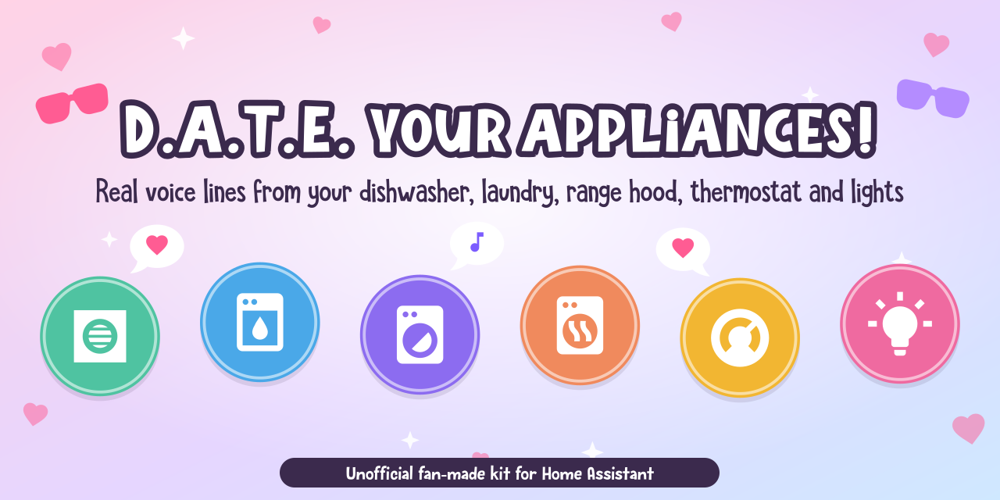
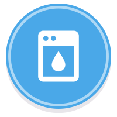
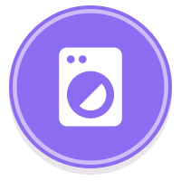
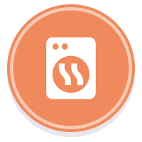

<p align="center">
  
</p>

<h1 align="center">D.A.T.E. your appliances!</h1>

<p align="center">
  Make your real appliances talk like their <a href="https://store.steampowered.com/app/2201320/"><b><i>Date Everything!</i></b></a> characters.<br>
  No Dateviators required. 
</p>

<p align="center">
  <a href="https://www.home-assistant.io/"></a>
  <a href="https://store.steampowered.com/app/2201320/"></a>
  <a href="LICENSE"></a>
  <a href="https://www.reddit.com/user/AriAzure/"></a>
</p>

<p align="center">
  <a href="#step-0-get-home-assistant-skip-if-you-have-it"><b>Get started</b></a> ·
  <a href="#step-3-add-the-characters"><b>Add the characters</b></a> ·
  <a href="#what-it-costs"><b>What it costs</b></a> ·
  <a href="#questions"><b>Questions</b></a> ·
  <a href="#made-by"><b>Made by</b></a>
</p>

> [!NOTE]
> **Unofficial fan project.** I'm not affiliated with, endorsed by, or connected to Sassy Chap Games, Team17 or *Date Everything!* in any way. I'm just a fan who wanted their dishwasher to flirt back. All characters, voices and names belong to their owners.

## Meet the cast

| | Character | Your device | What they say |
|:---:|---|---|---|
|  | **Dishy** | Dishwasher | An intro and a start line when a wash starts, the Lime Dawn line when the door pops open to dry, a victory line when it's done |
|  | **Washford** | Washer | Start lines (heavy loads, cold water and delayed starts get their own), washing and spinning lines, finished lines |
|  | **Drysdale** | Dryer | Start, cooling down, wrinkle care, finished. And he and Washford **talk to each other** when the wet clothes move over. |
|  | **Hector** | Range hood | Fan on and off, smoky kitchen (and a nudge to turn him on), air cleared, filter full, filter cleaned |
|  | **Airyn** | Thermostat | Heat/cool switches, too dry or humid, offline and back, filter reminders. Kept quiet on purpose. |
|  | **Lux** | Lights | On, off, brighter, dimmer, and complaints when a light is offline. By default only when you use a voice command. |

Every character has an on/off switch for each kind of line, stays quiet at night (you pick the hours, with a later start on weekends), and picks a random line each time.

**See it in action:** watch Dishy, Hector, Airyn and Washford talk in [my post on r/DateEverything](https://www.reddit.com/r/DateEverything/comments/1x8lg1o/now_i_get_to_date_my_appliances_no_dateviators/)!

## How it works

The appliances don't talk themselves. **Home Assistant**, a free smart home manager app, does the talking:

1. Your smart appliances already report what they're doing ("cycle started", "door opened", "filter full") to their own apps, like Samsung SmartThings or Google Nest.
2. Home Assistant connects to those apps, so it hears every update in one place.
3. When something happens, a rule in Home Assistant picks a matching voice line and plays it on your smart speaker in that room.

This kit gives you those rules (as Home Assistant "blueprints", which are fill-in-the-blanks automations) and a tool to make the voice clips.

## What you need

- **Smart appliances that already work in their own app.** I used Samsung appliances (in the **SmartThings** app) and a **Google Nest** thermostat. If you can see your dishwasher's cycle in its app, you're probably good. Other brands can work too, they just weren't tested.
- **A smart speaker.** Lots of kinds work: **Google Nest / Google Home** speakers, **Apple HomePod** and **Apple TV**, **Sonos**, Chromecast speakers, and most other speakers that can connect to Home Assistant. (Sorry, Alexa fans: **Amazon Echo speakers don't work.** Amazon doesn't let Home Assistant play your own sound clips on them.)
- **Home Assistant**, the free app that ties it all together. Don't have it yet? Step 0 walks you through it.
- **A computer** (Mac, Windows or Linux) for about 15 minutes to make the voice clips.

## What it costs

The kit and Home Assistant itself are **free**. Some of the connections to your devices aren't:

| What | Cost | Who needs it |
|---|---|---|
| **Samsung SmartThings API** | **$4.99/month**, [announced by Samsung](https://blog.smartthings.com/smartthings-updates/a-new-enhanced-smartthings-api-experience/) to start around October 2026 (free until then) | Samsung appliances (Dishy, Washford, Drysdale, Hector) connected through the SmartThings integration |
| **Google Nest Device Access** | **$5 one time**, paid to Google ([details](https://www.home-assistant.io/integrations/nest/)) | Google Nest thermostats (Airyn) |
| **Home Assistant Cloud** | **$6.50/month** or $65/year, 31-day free trial ([pricing](https://www.nabucasa.com/pricing/)) | Only if you want Lux to react to "Hey Google" voice commands. Optional, and it supports the Home Assistant project. |
| **A box to run Home Assistant on** | About **$199** for a Home Assistant Green, or free on a computer you already have | Everyone who doesn't have Home Assistant yet (see Step 0) |

**A free alternative to the SmartThings fee:** [**LocalThings**](https://github.com/mbillow/localthings) is a free, open-source Home Assistant integration that talks to newer Samsung appliances (roughly 2022 and later) directly over your home Wi-Fi, without Samsung's paid cloud. It covers washers, dryers, dishwashers, range hoods and more, and installs through HACS. Heads up: **I haven't tried it myself.** People on r/homeassistant recommended it. These blueprints were built on the SmartThings sensors, so with LocalThings you may need to pick different sensors, or the states may have different names. If you get it working, please share how!

## Step 0: Get Home Assistant (skip if you have it)

Home Assistant is a free app that runs on a computer that stays on at home all the time, like your Wi-Fi router does. That's what talks to your appliances and speakers, so it has to live in your house and stay on.

### Pick how you want to run it

You don't need to build anything. Pick whichever sounds easiest for you:

**Option 1: Buy the ready-made box (easiest, no tech skills)**
[**Home Assistant Green**](https://www.home-assistant.io/green/) is a little box made by the Home Assistant team with everything already installed. It's about **$199 USD**. In the box: the hub, a power plug and a network cable.
- Plug it into power, plug the cable into your internet router, and wait. That's the whole setup. ([Setup guide](https://support.nabucasa.com/hc/articles/24737667232413))
- Where to buy: the [Home Assistant Green page](https://www.home-assistant.io/green/) lists official stores for your country (in the US: Amazon, ameriDroid, Seeed Studio, CloudFree and others).

**Option 2: Use a computer you already have (free)**
Home Assistant can run inside a free program on a **Windows PC** or **Mac**, a bit like an app in its own window. The catch: that computer has to **stay on and awake all the time**, or your characters go quiet. Good for trying it out, or if you have a desktop that's always on.
- [Windows guide](https://www.home-assistant.io/installation/windows)
- [Mac guide](https://www.home-assistant.io/installation/macos)

**Option 3: You already have a home server or NAS (Synology, Unraid and so on)**
Most of them can run Home Assistant too. [Guide for other systems](https://www.home-assistant.io/installation/alternative)

**Option 4: For tinkerers**
A **Raspberry Pi 4 or 5** ([guide](https://www.home-assistant.io/installation/raspberrypi)), or an old laptop or mini PC turned into a dedicated Home Assistant box ([guide](https://www.home-assistant.io/installation/generic-x86-64)). Cheaper if you already own the hardware, but you'll be copying Home Assistant onto a memory card or drive yourself.

Not sure? **Get the Green.** Every option is also on the [official installation page](https://www.home-assistant.io/installation/).

### Set it up

1. Wait about 5 to 20 minutes after plugging it in (the first start is slow).
2. On a phone or computer on the **same Wi-Fi**, open **http://homeassistant.local:8123** in your web browser. You can also get the **Home Assistant** app for [iPhone](https://apps.apple.com/app/home-assistant/id1099568401) or [Android](https://play.google.com/store/apps/details?id=io.homeassistant.companion.android), which finds it for you.
3. Click **Create my smart home**, make an account (just for your house, it doesn't leave your home), and set your location.
4. Home Assistant shows devices it already found on your Wi-Fi. Add the ones you want.

### Connect your appliances and speakers

In Home Assistant, a connection to another app or brand is called an **integration**. You add each one like this: **Settings** (bottom left) > **Devices & services** > **Add integration** (bottom right) > type the brand name > follow the steps. Often it already shows up at the top under **Discovered**, and you only click **Add**.

Add the ones for what you have:

| You have | Add this integration | Notes |
|---|---|---|
| Samsung dishwasher, washer, dryer or range hood (Dishy, Washford, Drysdale, Hector) | **SmartThings** | Sign in with your Samsung account. Heads up: Samsung [announced](https://blog.smartthings.com/smartthings-updates/a-new-enhanced-smartthings-api-experience/) it will start charging **$4.99/month** (the SmartThings "Personal Plan") for Home Assistant to connect, starting around October 2026. Free until then. Free alternative: [LocalThings](https://github.com/mbillow/localthings) (see [What it costs](#what-it-costs)). |
| Google Nest / Google Home speakers or Chromecast | **Google Cast** | Usually shows up under **Discovered** on its own. One click. |
| Sonos speakers | **Sonos** | Usually discovered on its own. |
| Apple HomePod or Apple TV | **Music Assistant** | A free Home Assistant app that turns HomePods and Apple TVs into speakers Home Assistant can play to (over AirPlay). Install **Music Assistant** from **Settings > Apps** (called "Add-ons" in older versions), start it, then add the **Music Assistant** integration. AirPlay speakers show up on their own. ([Guide](https://www.music-assistant.io/installation/)) Pick the HomePod's Music Assistant speaker in the character settings. |
| Amazon Echo | Not supported | Amazon blocks custom sound clips on Echo speakers. Use any other speaker for the characters. |
| Google Nest thermostat (Airyn) | **Google Nest** | The trickiest one. Google charges a one-time **$5** fee and makes you set up a "developer" project. Follow the [official Nest guide](https://www.home-assistant.io/integrations/nest/) step by step, it takes about 30 minutes. |
| Ecobee, Honeywell or other thermostat (Airyn) | Search the brand name | Most popular thermostats have one. |
| Smart lights (Lux) | Search the brand name (Philips Hue, Lutron, TP-Link Kasa, and so on) | If your lights already work with Google Home or Alexa, there's usually one. |

**For Lux and voice commands:** if you want Lux to react when you say "Hey Google, turn on the lights", Google Assistant has to control your lights *through* Home Assistant. The easy way is **Home Assistant Cloud** (a paid subscription that also supports the project): **Settings > Home Assistant Cloud**, sign up, then turn on **Google Assistant**. ([Guide](https://www.nabucasa.com/config/google_assistant/)) Don't want that? In the Lux settings, pick **Voice, the app and automations** instead, and they'll talk when you use the Home Assistant app.

### Check that it worked

Go to **Settings > Devices & services > Devices** and click your dishwasher (or washer, range hood, thermostat). You should see things like **Machine state** and **Job state** changing when you run it. If you see those, you're ready for Step 1.

## Step 1: Make the voice clips

The clips aren't in this repo because the voices belong to the game and its voice actors. Instead there's a list of exactly where each line starts and stops in these "All Voice Lines" videos by [**illblux2748**](https://www.youtube.com/channel/UCNfvgU0e7OwQipFRsy32lyQ) on YouTube, and a tool that cuts them out for you:

| Character | Voiced by | Video |
|---|---|---|
| Dishy | Eric Bauza | [Watch on YouTube](https://youtu.be/ZjMNDCZjNKE) |
| Washford | David Sobolov | [Watch on YouTube](https://youtu.be/zZ9o5hCB8lw) |
| Drysdale | Neil Newbon | [Watch on YouTube](https://youtu.be/uRDZY6H8508) |
| Hector | Christian Navarro | [Watch on YouTube](https://youtu.be/v_IfG6CpSd0) |
| Airyn | Mary Elizabeth McGlynn | [Watch on YouTube](https://youtu.be/_MCr0tZJPkE) |
| Lux | Michael Lorz | [Watch on YouTube](https://youtu.be/uc6YdoorwGk) |

This step uses a few typed commands. You don't need to know any coding: copy each gray box, paste it, press **Enter**, and wait for it to finish. Every gray box on this page has a copy button in its top right corner.

**Where you type them:**
- **Mac:** the **Terminal** app. Press **Command + Space**, type `Terminal`, press **Enter**.
- **Windows:** **PowerShell**. Click Start, type `PowerShell`, press **Enter**.

**1. Install the free tools** (one time only). They're well-known, safe programs: one saves a video's sound, one cuts audio.

On a **Mac**, first install [Homebrew](https://brew.sh) (copy the one line on its home page into Terminal and follow what it says), then paste:

```
brew install ffmpeg yt-dlp
```

On **Windows**, paste this, then close PowerShell and open it again:

```
winget install ffmpeg yt-dlp.yt-dlp Python.Python.3.12
```

**2. Download this kit.** At the top of this page, click the green **Code** button, then **Download ZIP**. Open the ZIP so you get a folder called `date-everything-home-assistant-main`, and leave it in your **Downloads** folder.

**3. Go into that folder** in Terminal / PowerShell by pasting:

```
cd ~/Downloads/date-everything-home-assistant-main
```

**4. Save the sound from the videos.** This puts them in a new `downloads` folder inside the kit. It takes a few minutes.

```
yt-dlp -x -o "downloads/%(id)s.%(ext)s" https://youtu.be/ZjMNDCZjNKE https://youtu.be/zZ9o5hCB8lw https://youtu.be/uRDZY6H8508 https://youtu.be/v_IfG6CpSd0 https://youtu.be/_MCr0tZJPkE https://youtu.be/uc6YdoorwGk
```

Only want some characters? Delete the other characters' links from the line before pressing Enter (the table above shows which link is who). Please keep the clips for your own home.

**5. Cut the voice lines.** On a **Mac**:

```
python3 tools/make_clips.py downloads
```

On **Windows**:

```
python tools/make_clips.py downloads
```

You'll see each clip's name scroll by. When it says **Done**, there's a new `date_everything` folder inside the kit with 172 short voice clips, all at the same volume.

<details>
<summary>Only want some characters, or a clip sounds cut off?</summary>

- Only some characters: add `--only` and their names, for example `python3 tools/make_clips.py downloads --only dishy,lux`. Names: `dishy`, `washford`, `drysdale`, `duo` (Washford and Drysdale talking together), `hector`, `airyn`, `lux`.
- A clip starts a hair late or cuts off a word: run it again with `--shift -0.05` (or `--shift 0.05`) at the end.

</details>

## Step 2: Put the clips in Home Assistant

1. In Home Assistant, open **Media** in the sidebar, then **My media**.
2. Click **Create folder** (the folder icon) and name it `date_everything`.
3. Open the folder, click **Upload**, and select all the MP3s from the `date_everything` folder you made.

## Step 3: Add the characters

Click a button to add that character's blueprint to your Home Assistant:

| | Character | Add it |
|:---:|---|---|
|  | **Dishy** | [](https://my.home-assistant.io/redirect/blueprint_import/?blueprint_url=https%3A%2F%2Fgithub.com%2FSeriousBug%2Fdate-everything-home-assistant%2Fblob%2Fmain%2Fblueprints%2Fautomation%2Fdishy.yaml) |
|  | **Washford & Drysdale** | [](https://my.home-assistant.io/redirect/blueprint_import/?blueprint_url=https%3A%2F%2Fgithub.com%2FSeriousBug%2Fdate-everything-home-assistant%2Fblob%2Fmain%2Fblueprints%2Fautomation%2Fwashford_drysdale.yaml) |
|  | **Hector** | [](https://my.home-assistant.io/redirect/blueprint_import/?blueprint_url=https%3A%2F%2Fgithub.com%2FSeriousBug%2Fdate-everything-home-assistant%2Fblob%2Fmain%2Fblueprints%2Fautomation%2Fhector.yaml) |
|  | **Airyn** | [](https://my.home-assistant.io/redirect/blueprint_import/?blueprint_url=https%3A%2F%2Fgithub.com%2FSeriousBug%2Fdate-everything-home-assistant%2Fblob%2Fmain%2Fblueprints%2Fautomation%2Fairyn.yaml) |
|  | **Lux** | [](https://my.home-assistant.io/redirect/blueprint_import/?blueprint_url=https%3A%2F%2Fgithub.com%2FSeriousBug%2Fdate-everything-home-assistant%2Fblob%2Fmain%2Fblueprints%2Fautomation%2Flux.yaml) |

The buttons don't work for you? In Home Assistant go to **Settings > Automations & scenes > Blueprints > Import blueprint** and paste the link to the file in [`blueprints/automation`](blueprints/automation).

Then for each one:

1. Go to **Settings > Automations & scenes > Blueprints**, click the character, and you get a new automation to fill in.
2. Pick your appliance's sensors and your speaker. For Samsung appliances in SmartThings, the sensors are called **Machine state** and **Job state** on the appliance's device page.
3. Look through **Options** and turn off anything you don't want. The **Voice lines** section lists which clips play when. You can delete or add file names there.
4. **Save.** Now run your dishwasher (or turn on your range hood) and listen.

### Notes per character

- **Dishy:** add the **Completion time** sensor too, or he can't say the Lime Dawn line when the door opens. Short cycles like Pre-Blast stay silent. If Home Assistant restarts mid-wash, that wash is quiet.
- **Washford & Drysdale:** the "handoff" duo plays when the dryer starts within 90 minutes of the washer finishing. If both run at once, they flirt.
- **Hector:** the smoky-air lines need the range hood's air quality sensors. Without them he only talks for fan on/off and running long.
- **Airyn:** for filter reminders, create a **Date** helper (Settings > Devices & services > Helpers > Create helper > Date and/or time, date only) and set it to when you last changed the filter. Add a **Button** helper too, and press it after each new filter.
- **Lux:** they talk on the speaker in the light's room. That's the speaker in the same area, or a speaker with the room's name in its name ("Living Room speaker"). With **Only voice commands**, add your voice assistant's user ID (see the field's description). Prefer they react to the app too? Pick the second option.

## How the clips were made

Each video is up to 50 minutes of lines back to back. Speech recognition found where every line starts and ends, each cut was nudged into the quiet gap between lines, and every finished clip was transcribed again to check it. Those start and end times are what's in [`clips/cutlist.csv`](clips/cutlist.csv). `make_clips.py` cuts at those times, evens out the volume so every character is equally loud, and adds a tiny pause before and after each line.

I left out the dating, spicy and insulting lines, so the house stays family-friendly(ish). Lux still curses.

## Questions

<details>
<summary><b>Does this cost anything?</b></summary>

The kit and Home Assistant are free. Samsung's planned SmartThings fee, Google's one-time Nest fee, the optional Home Assistant Cloud and a box to run it on can cost money. See [What it costs](#what-it-costs) for the full list, and a free alternative to the SmartThings fee.
</details>

<details>
<summary><b>My appliances aren't Samsung. Will it work?</b></summary>

Maybe. The laundry and dishwasher characters expect the "Machine state" and "Job state" that Samsung appliances report. Hector works with any range hood or fan that Home Assistant can see (the smoky-air lines need air quality sensors). Airyn works with most thermostats, and Lux with almost any smart light.
</details>

<details>
<summary><b>Can I use my Alexa / Amazon Echo?</b></summary>

Sorry, no. Amazon doesn't let Home Assistant play your own sound clips on Echo speakers. Google Nest, Apple HomePod, Sonos and most other speakers work.
</details>

<details>
<summary><b>Will they talk at 3 in the morning?</b></summary>

No. Each character has quiet hours you set yourself, with a later start on weekends. By default they talk from 9 AM (11 AM on weekends) until 3 AM.
</details>

<details>
<summary><b>Can I pick which lines they say?</b></summary>

Yes. Every character has a **Voice lines** section listing the clip file names for each moment. Delete the ones you don't like, or move a line to a different moment. The full list of clips is in <a href="clips/cutlist.csv">clips/cutlist.csv</a>.
</details>

<details>
<summary><b>Why aren't the voice clips included?</b></summary>

They belong to the game and its voice actors, so the kit only shares the timestamps and a tool that cuts them from the YouTube videos for your own use.
</details>

## Credits

- [***Date Everything!***](https://store.steampowered.com/app/2201320/) is made by **Sassy Chap Games** and published by **Team17**. This is an unofficial fan project: I'm not affiliated with, endorsed by or sponsored by Sassy Chap Games or Team17. All character voices belong to the game and its wonderful voice cast. Go play it!
- Voice line videos: [**illblux2748**](https://www.youtube.com/channel/UCNfvgU0e7OwQipFRsy32lyQ) on YouTube. Thank you!
- Icons: [Material Design Icons](https://pictogrammers.com/library/mdi/) by the [Pictogrammers](https://pictogrammers.com/) community, used under the [Apache License 2.0](assets/mdi/LICENSE). It's the same open-source icon set Home Assistant uses.
- Banner fonts: [Crayonest](https://www.dafont.com/crayonest.font) by Maulana Creative, [KG She Persisted](https://www.kimberlygeswein.com) by Kimberly Geswein and [Bugbear](https://www.1001freefonts.com/bugbear.font) by Hanoded, the same fonts the game uses, all free for personal use. The font files aren't included in this repo.

## Made by

**Ari Azure** (Ari Barmore-Genc).

- Reddit: [u/AriAzure](https://www.reddit.com/user/AriAzure/)
- Everything else: [linktr.ee/ariazure](https://linktr.ee/ariazure)

I don't have a GitHub account, so my husband is letting me borrow his (that's why this lives under **SeriousBug**). Questions or ideas? Comment on [the Reddit post](https://www.reddit.com/r/DateEverything/comments/1x8lg1o/now_i_get_to_date_my_appliances_no_dateviators/) or message me on Reddit.

The code and blueprints in this repo are MIT licensed (see [LICENSE](LICENSE)). That covers the code only, not the game's audio.
